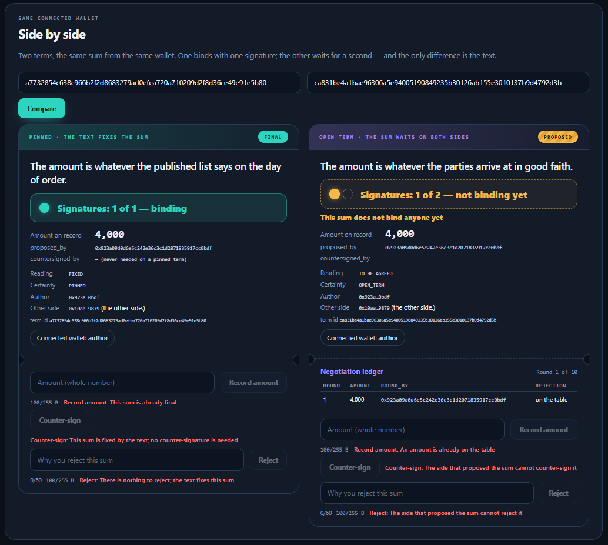
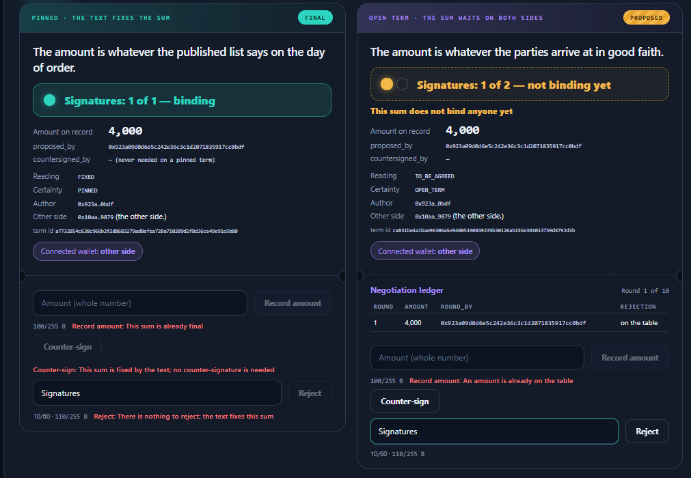
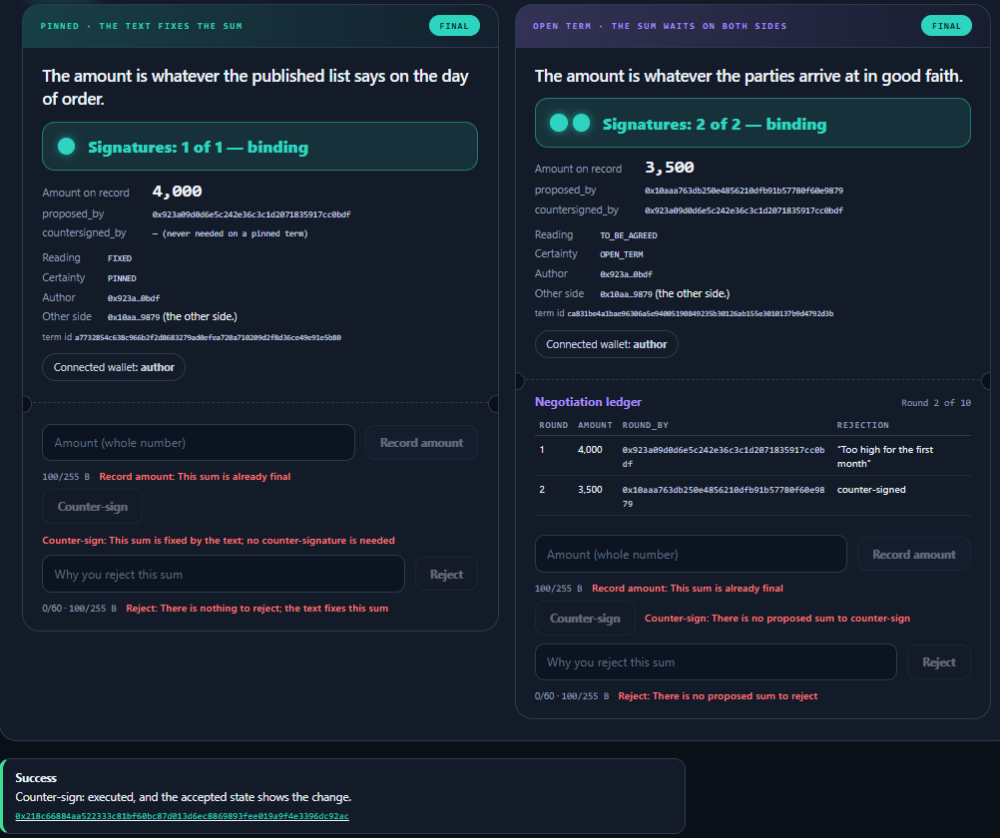

Pinned does not ask which side of a number is the wrong side, and it does not grade certainty on a scale. It asks whether a stranger holding this text and the relevant records could arrive at the sum alone — and it turns that answer into the number of signatures a later write needs before the sum binds anybody.

<p></p>

# Pinned

**The contract holds no money and moves no money. It is not an escrow.** It records a sum, how many signatures that
sum needs and how many it has.

A GenLayer dApp on StudioNet (chain 61999) built on the Intelligent Contract `TermCertain`
(`contracts/TermCertain.py`, py-genlayer v0.2, `# v0.2.16`).

| | |
|---|---|
| Live app | https://pinned-three.vercel.app |
| Project contract | [`0x03bd13f0E6879fd4b6b2f85c642C70E7B3e027f2`](https://explorer-studio.genlayer.com/address/0x03bd13f0E6879fd4b6b2f85c642C70E7B3e027f2) |
| Intelligent Contract (separate submission) | `0x2719e3e965ced1c6bb227ae717A57287AE1D430a` |
| Source SHA-256 | `f97f02ce20d5395791eccdaabeabed3ba434155a2695e7bd0b9f8f7ccaf357a5` (`SOURCE_SHA256.txt`) |
| Evidence | `RUNTIME_EVIDENCE.md` · `TESTING.md` |

## What it does

An author opens a term naming the other side and a text about a sum. GenLayer validators read it **once**:

- **`FIXED`** → `PINNED`, **1 signature**: the author records the sum once and it is FINAL at once;
- **`TO_BE_AGREED`** → `OPEN_TERM`, **2 signatures**: either side proposes a sum, which binds nobody until the other
  side counter-signs; the other side may reject it instead, and the term opens again, up to ten proposals.

On a pinned term, Counter-sign and Reject do not exist; on an open term, the side that proposed a sum can neither sign
nor reject it. Unclear output fails safe to two signatures: when it is unclear who agreed to what about money, nobody has.

The same method, the same wallet, the same number 4000 — one term is FINAL, the other is a proposal. The only
difference between the two terms is the text.

## What the app shows



- **A signature gauge** under every text, read from `get_term`: *Signatures: 0 of 1 — not binding yet* the moment a
  term is opened, then *1 of 1 — binding* or *1 of 2 — not binding yet*, then *2 of 2 — binding*. The app never works
  out the threshold itself.
- **A state chip**: AWAITING, FINAL, or PROPOSED — striped amber, with *This sum does not bind anyone yet*.
- **Record amount, Counter-sign and Reject** are on every term. When disabled they show the contract's own sentence for
  the step that blocked them — on a pinned term two different sentences, *This sum is fixed by the text; no
  counter-signature is needed* and *There is nothing to reject; the text fixes this sum*.
- **The negotiation ledger** of an open term: every round, its amount, the full address that proposed it, and the
  rejection note; *Round N of 10*.
- **Side by side**: two terms seen by the same wallet.
- The id of a new term is computed locally and shown before sending; the app checks the accepted state first and never
  sends a duplicate. Success is reported only after the transaction is ACCEPTED and the reloaded state shows the change.
  Amounts are kept as decimal strings end to end (10^18 does not fit a JS number). A live meter blocks calldata over
  255 bytes.





## How to try it

Open your own terms — nothing here depends on shared state. You need **two wallets of your own** on GenLayer StudioNet
to see the whole loop; one wallet is enough to open terms, record a sum and see the disabled buttons. **One wallet alone
can never take an open term to FINAL** — that is the mechanism, not a fault.

1. Connect your **first wallet** (author). On *Open a term*, enter your **second wallet** as the other side, label
   `the other side`, and `The amount is whatever the published list says on the day of order.` Open it, then open
   `The amount is whatever the parties arrive at in good faith.` Both gauges read 0 of 1 and 0 of 2. Copy both ids.
2. On both, record `4000`. Open *Side by side*: *Signatures: 1 of 1 — binding* next to *Signatures: 1 of 2 — not
   binding yet*.
3. Switch MetaMask to your **second wallet**. On the first term, Counter-sign and Reject are disabled with two different
   sentences. On the second, reject with a note, then propose `3500`.
4. Switch back to the author and counter-sign: 2 of 2, binding; the ledger shows two rounds from two wallets.

## Methods

| Write | Who | Notes |
|---|---|---|
| `open_term(other_wallet, other_label, text)` | author | the only model call |
| `record_amount(term_id_hex, value)` | PINNED: author · OPEN_TERM: either side | state → caller → 1 ≤ value ≤ 10^18 → round cap |
| `countersign(term_id_hex)` | OPEN_TERM, not the proposer | threshold → PROPOSED → not the proposer → a named side |
| `reject_amount(term_id_hex, note)` | OPEN_TERM, not the proposer | same order, then a 1–60 character note |

Views: `get_term` (every field plus `outcome`, `signatures_required`, `signatures_held`, `binding`), `get_round`,
`get_rounds`, `get_rubric`, `get_limits`. Unknown id → `"{}"`. No preview or dry-run view. Full rules: `LOCKED_SPEC.md`.

## Run locally

```
npm ci
npm run dev          # http://localhost:5173, proxied to StudioNet
npm test             # frontend logic tests
npm run build
python3 -m pytest tests/contract -q    # contract tests in GenLayer Direct Mode
```

`VITE_CONTRACT_ADDRESS` overrides the Project address in `src/lib/config.ts`.

## Honest limitation

1. **The contract holds no money and moves no money.** It records a sum, how many signatures it needs and how many it
   has. It is not an escrow.
2. **FINAL binds on this ledger, not in law.** The contract enforces nothing off chain, collects nothing and replaces no
   agreement. Its value is that the threshold is frozen before any number exists, so neither side picks the threshold
   after seeing the number.
3. **A wrong `FIXED` is the main risk, and no method undoes it** — a sum would bind the other side without its
   signature. Nets: the fail-safe, the signature gauge shown before any amount is recorded, and the error showing at the
   first `record_amount`, when the other side sees FINAL without having signed. On StudioNet the validators were split
   on X3 (a rule, "the same as the first") and needed two leader rotations to accept `FIXED`.
4. **A wrong `TO_BE_AGREED` leaves the author waiting.** The other side can stall, and a sum the text did pin stays
   unbound. The cost falls on the writer of the unclear sentence and nobody is bound to a sum they did not accept — on
   purpose.
5. **The author declares the other side's wallet.** `open_term` refuses the author's own wallet and `countersign`
   refuses the proposer, but a second wallet is cheap — and here that matters most, because the whole value of the
   threshold of 2 is that the second signature comes from someone else. The contract cannot prove that two wallets are
   two people. This is the largest limitation of the project.
6. **`MAX_ROUNDS = 10` and `MAX_AMOUNT = 10^18` are hard limits.** If the tenth proposal is rejected, the term stays in
   AWAITING for good: no new proposal, no FINAL, no way out. (Right after the tenth proposal the term is still PROPOSED
   and can be signed.) `MAX_AMOUNT` also means the app is not meant for amounts in wei.

The contract accepts 600 characters of text, but `open_term` at the caps measures 759 bytes of calldata; only texts up
to about 163 characters fit the 255-byte limit. Longer ones would be refused by the RPC, and the app blocks them.

License: MIT.
